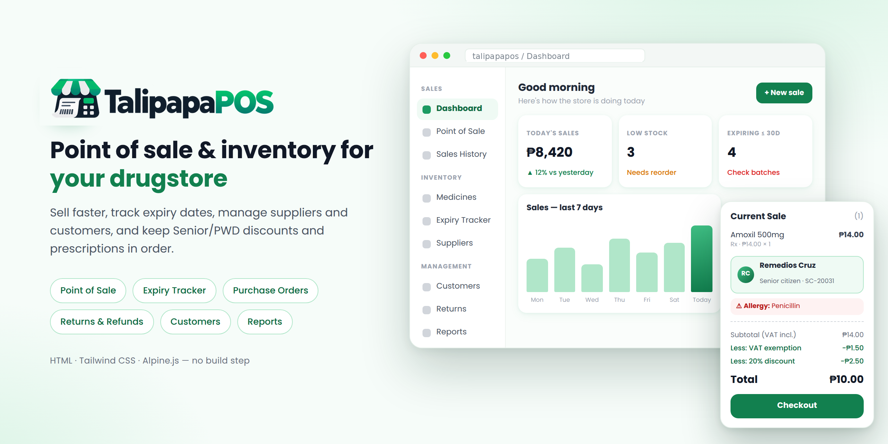

<p align="center">
  
</p>

<h1 align="center"></h1>

<p align="center">
  A point-of-sale and inventory system for small pharmacies and drugstores in the Philippines.<br>
  Built with plain HTML, Tailwind CSS and Alpine.js — no build step, no backend required.
</p>

<p align="center">
  
  
  
  
</p>

---

## Contents

- [Features](#features)
- [Pages](#pages)
- [Getting started](#getting-started)
- [Trying it out](#trying-it-out)
- [Project structure](#project-structure)
- [How data is stored](#how-data-is-stored)
- [Known limitations](#known-limitations)
- [Roadmap](#roadmap)
- [Contributing](#contributing)
- [License](#license)

## Features

**Selling**
- Fast point of sale with product search, barcode/SKU scanning (press Enter), and a switchable large / grid / list product view.
- Philippine tax rules built in: prices include 12% VAT, and **Senior Citizen / PWD** sales are VAT-exempt with a 20% discount (ID number required).
- Prescription (Rx) items require the patient name, doctor and PRC number before checkout.
- Cash, GCash and card payments, with quick-cash buttons, change calculation, an order summary step, and a printable receipt.
- Pick a saved customer at the counter: their discount type and ID fill in automatically, and any recorded **allergies** are flagged.
- Sales history with search, filters, CSV export and voiding (a reason is required).

**Inventory**
- Medicine catalogue with brand/generic names, strength, form, category, SKU, batch, cost, price and reorder level.
- Expiry tracker that groups batches into 30 / 60 / 90-day buckets, and lets you dispose of or return expired and near-expiry stock with a log.
- Suppliers and purchase orders (draft → ordered → received / cancelled).

**Management**
- Customers with type (Regular / Senior / PWD), ID number, allergies, conditions, notes and purchase history.
- Returns and refunds with reasons, item condition, restock-or-dispose handling, approval flow, and refund slips.
- Expense tracking with categories, payment methods and recurring bills.
- Reports: sales trend, payment mix, discounts given, top medicines, category breakdown, profit, and reorder / expiry lists, with CSV export.
- Profile (PRC / LTO details), settings, backup export, and login / register / 404 pages.

**Interface**
- Responsive layout with a collapsible sidebar and a mobile bottom-sheet cart.
- Keyboard-accessible dialogs with focus trapping and screen-reader labels.

## Pages

| Page | File | What it does |
| --- | --- | --- |
| Dashboard | `index.html` | Today's sales, 7-day chart, payment mix, low stock, expiring items, open orders |
| Point of Sale | `pos.html` | Cart, customer picker, discounts, checkout and receipt |
| Sales History | `sales.html` | Browse, filter, export and void sales |
| Products | `product.html` | Add, edit, view and delete products |
| Expiry Tracker | `expiry.html` | Track expiring batches and log disposals |
| Suppliers | `suppliers.html` | Supplier directory |
| Purchase Orders | `purchase-orders.html` | Create and manage orders to suppliers |
| Customers | `customers.html` | Customer records, allergies and purchase history |
| Returns & Refunds | `returns.html` | Process and approve returns |
| Expenses | `expenses.html` | Record store expenses |
| Reports | `reports.html` | Sales, profit and inventory reports |
| My Profile | `profile.html` | Personal, professional and store details |
| Settings | `settings.html` | Preferences, backup and reset |
| Login / Register / 404 | `login.html`, `register.html`, `404.html` | Account and error pages |

## Getting started

There is nothing to install or build.

**Option 1 — open the file**

Open `index.html` in your browser.

**Option 2 — run a local server** (recommended)

```bash
# from the project folder
python3 -m http.server 8000
# then visit http://localhost:8000
```

> **Internet connection needed.** Tailwind CSS, Alpine.js and the Poppins font are loaded from CDNs, so the pages need to be online the first time they load. To work fully offline, download those files and point the `<script>` / `<link>` tags to your local copies.

## Trying it out

The app starts with sample medicines, suppliers, customers, purchase orders, expenses and returns so every page has something to show.

1. On the **Dashboard**, **Sales History** or **Returns** page, click **Load sample sales** to fill in demo sales.
2. Open **Point of Sale**, add a medicine, and choose a saved customer (try *Remedios Cruz*, a Senior Citizen) to see the VAT exemption and 20% discount applied.
3. Complete the sale, then check **Sales History** and the customer's profile on **Customers**.
4. Try a refund on **Returns & Refunds**, or add a medicine on **Medicines**.

Sample expiry dates are relative to today, so every status (expired, expiring soon, OK) always appears in the demo.

## Project structure

```
talipapapos/
├── index.html              # Dashboard
├── pos.html                # Point of sale
├── sales.html              # Sales history
├── product.html            # Product catalogue
├── expiry.html             # Expiry tracker
├── suppliers.html          # Suppliers
├── purchase-orders.html    # Purchase orders
├── customers.html          # Customers
├── returns.html            # Returns & refunds
├── expenses.html           # Expenses
├── reports.html            # Reports
├── profile.html            # My profile
├── settings.html           # Settings
├── login.html              # Sign in
├── register.html           # Create account
├── 404.html                # Not found
├── docs/
│   └── preview.png         # README banner
└── assets/
    ├── css/style.css       # Shared styles
    ├── js/
    │   ├── main.js         # Storage helpers, navigation, shared page logic
    │   └── data.js         # Sample medicines and sample sales
    └── img/                # Medicine-form icons (tablet, capsule, bottle…)
```

Each page is a self-contained HTML file with its own Alpine.js component at the bottom. Shared behaviour (sidebar, toasts, dialogs, notifications) lives in `assets/js/main.js` and is spread into every page through `sharedChrome()`.

## How data is stored

TalipapaPOS has no backend. Records are saved in your browser's `localStorage`, so they stay on that browser and device.

| Data | Storage key |
| --- | --- |
| Sales | `pp-sales` |
| Customers | `pp-customers` |
| Suppliers | `pp-suppliers` |
| Purchase orders | `pp-purchase-orders` |
| Returns | `pp-returns` |
| Expenses | `pp-expenses` |
| Profile | `pp-profile` |
| Settings | `pp-settings` |
| Expiry disposal log | `pp-expiry-log` |

Each store is a small object in `main.js` (for example `ppSales`, `ppCustomers`) with `load()` and `save()` methods. To connect a real database later, replace those methods with API calls.

## Known limitations

This is a front-end prototype, and some parts are not connected yet:

- **Stock levels are not shared between pages.** Medicines are loaded from `data.js` on each page, so selling an item, receiving a purchase order, restocking a return, or editing a medicine does not carry over to other pages or survive a refresh.
- **Settings are saved but not applied.** The VAT rate, discount rate and low-stock thresholds are currently fixed values (12%, 20%, 90 days).
- **Refunds are not subtracted from reports.**
- **Notifications are sample text,** not generated from real stock or expiry data.
- **Login and register are placeholders.** There is no real authentication, so do not use this to protect real data.
- Data lives in one browser only; clearing site data erases it.

## Roadmap

- [ ] Shared inventory store so sales, purchase orders, returns and disposals update stock everywhere
- [ ] Apply Settings (VAT, discount rate, thresholds, receipt footer) across the app
- [ ] Subtract refunds from sales and profit reports
- [ ] Real notifications from low-stock and expiry data
- [ ] Backend API and database, with real authentication and user roles
- [ ] Offline support (PWA) and bundled local copies of Tailwind and Alpine

## Contributing

Issues and pull requests are welcome. For larger changes, please open an issue first to discuss what you would like to change.

When adding a page, follow the existing pattern: spread `sharedChrome('your-page.html')` into the Alpine component, and add the page to `getNavSections()` in `assets/js/main.js`.

## License

No license has been chosen yet. Add a `LICENSE` file (for example [MIT](https://choosealicense.com/licenses/mit/)) before sharing the project publicly, and update this section to match.
